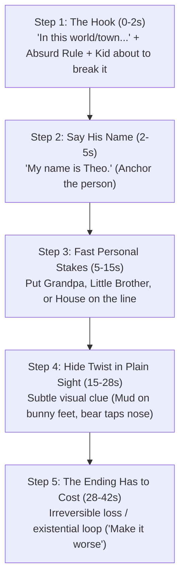

# Roblox Story Idea Generation Subskill (Theo's Viral Formula)

> *"Every story starts the same way. Three words: in this world, then a rule, then a kid who's about to break it.*  
> *My name is Theo, and I'm going to show you exactly how these videos are made because I finally figured out who they're made out of.*  
> *Find a kid who loves his family. Give him a rule. Take something away. And watch the numbers."*

This subskill is the dedicated idea, concept, and beat-script generator for `roblox-shorts-director`. It enforces the viral psychology, pacing, and retention mechanics of top-performing Roblox 3D storytelling Shorts.

---

## 🏛️ The 5 Mandatory Steps

Every story idea generated MUST follow these 5 steps in exact sequential order.



---

### Step 1: The Hook (0 – 2 Seconds)
- **Opening**: Starts with exactly three words: `"In this world, ..."` or `"In this town, ..."`.
- **Zero Intro Fluff**: Never start with "Hello", "Welcome", or setup narration. You have 2 seconds before the viewer scrolls.
- **The Absurd Rule**: Must be weird, tangible, and physical enough to stop a thumb immediately.
  - *Canonical Examples*:
    - *"Complain and your house shrinks."*
    - *"Ignore someone and they fade away."*
    - *"Say something angry and it comes true."*
    - *"Your hair color decides your whole life."*
    - *"Every word you speak drops your life counter."*
- **The Immediate Threat**: Followed instantly by the kid who is about to break it.

---

### Step 2: Say His Name (2 – 5 Seconds)
- **The Anchor**: Always declare the protagonist's identity right away:  
  `"My name is Theo..."` *(or selected character name)*.
- **Psychological Principle**: People do not remember abstract rules; they remember a person. Giving him a name binds empathy to the avatar before the catastrophe strikes.
- **Visual Staging**: Immediate cut to waist-up medium or face close-up so the character's facial expression and design register.

---

### Step 3: The Stakes Fast (5 – 15 Seconds)
- **The 15-Second Cutoff**: By 15 seconds in, whatever the protagonist loves most in the world MUST be directly on the line.
- **The Sacred Hierarchy of Loss**:
  1. **Grandpa** (wisdom, old bonds, fragile protection)
  2. **Little Brother / Little Sister** (innocence, dependence, vulnerability)
  3. **The Family House** (shelter, safety, home)
- **Clarity of Consequence**: The viewer must know *exactly* what is about to be destroyed if he slips. No vague threats.

---

### Step 4: Hide the Twist in Plain Sight (15 – 28 Seconds)
- **Rewatch Bait Mechanics**: Do NOT pull a random shock twist out of thin air. Hide a specific visual or physical clue early in the scene that only observant viewers spot on first watch.
- **Canonical Clues**:
  - *Mud on a bunny suit's feet — the exact same red clay mud from our basement.*
  - *A robot toy bear tapping his nose twice whenever a lie is spoken.*
  - *A ticking clock in the background running counter-clockwise.*
  - *A silhouette in the bedroom window holding the identical item stolen.*
- **The Retention Loop**:
  - The viewers who catch it feel brilliant and rush to the comments: *"WAIT AT 0:18 LOOK AT THE FEET!"*
  - The viewers who missed it watch the video a second time to verify, driving retention past 100%.

---

### Step 5: The Ending Has to Cost Something (28 – 42 Seconds)
- **The Metric Reality ("The 40k vs 1M Law")**:
  - **Happy Endings** (*"I said thank you and our house grew back"*, or *"I listened to Grandpa's fish story"*): ~30,000–40,000 views. Comforting, but forgettable.
  - **Tragic & High-Cost Endings** (*"I said something angry to my sister and lost her forever"*): **1,000,000+ views**.
  - **Audience Feedback Loop**: The comments will always demand: *"Do another one. Make it worse."*
- **The Three Viral Ending Archetypes**:
  1. **Irreversible Loss**: The rule is merciless. A careless word or selfish instinct permanently erases or changes someone they loved.
  2. **The Betrayal / Sacrifice**: Turned to stone and shattered, or sacrificed by the very family they were trying to save.
  3. **The Existential Meta-Loop**: Waking up back in the bedroom, family restored, knowing they are trapped in an infinite cycle where somebody is already writing what happens next.

---

## 📐 Idea Generation Workflow

When asked to generate story ideas or write a script:

1. **Extract/Pick the Core Absurd Rule**: Must fit the format `In this world, [Action] causes [Physical Consequence]`.
2. **Anchor Theo (Protagonist)**: Detail his look, his normal routine, and what he loves most.
3. **Establish the 15-Second Vulnerability**: Identify whether Grandpa, Little Brother, or the House is in immediate peril.
4. **Plant the Plain-Sight Clue**: Specify the exact visual asset / prop / keyframe detail visible during beats 4–6.
5. **Execute the Climax & "Make It Worse" Cost**: Craft the 3 climax shout words and the devastating final twist line.
6. **Output the Story Specification**: Ready for direct compilation into `stories/<slug>.py`.

---

## 📋 Idea Template

```markdown
### [STORY TITLE IN ALL CAPS]
- **The Absurd Rule**: "In this world, ..."
- **Protagonist**: Theo (preset: kid_boy / schoolboy)
- **What's at Stake (<15s)**: [Grandpa / Little Brother / Family House]
- **The Plain-Sight Clue**: [Visual detail placed at 18s that gives away the twist]
- **The Climax Shout Words**: [WORD 1!] [WORD 2!] [WORD 3!]
- **The Costly Ending**: [The tragic consequence or meta-loop that drives the comments]
```

---

## ⚡ Integration with `roblox-shorts-director`

When `roblox-shorts-director` is triggered to write a Short:
1. It queries `roblox-idea-generation` for the narrative structure.
2. It maps the 5 steps into the standard `BEATS` array:
   - `b1`: The 3-word rule hook (`"In this world..."`).
   - `b2`: Protagonist declaration (`"My name is Theo..."`).
   - `b3-b4`: The 15s stake introduction (Grandpa / Brother / House).
   - `b5-b7`: World reaction + plain-sight clue in 3D scene props.
   - `w1-w3`: Climax shouting beats (`shout: True`).
   - `b8-b10`: The cost, irreversible aftermath, and closing twist.
3. Compiles directly into `stories/<slug>.py` for preview stills and MP4 render.
